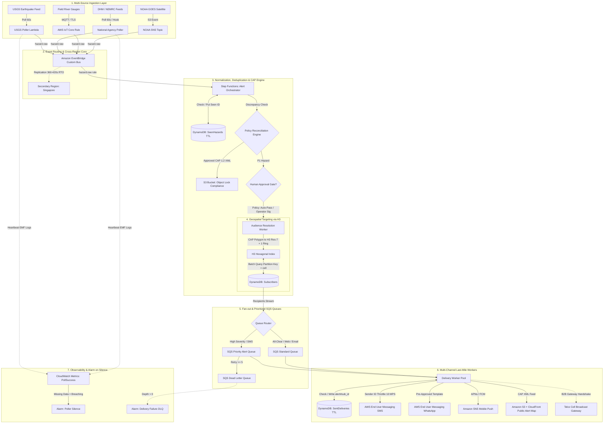

# Building a Disaster Alerting Pipeline on AWS: Ingestion, Geofencing, and Delivery When Networks Fail

*Nov 1, 2026 · @Binod*

---
## The 23:47 problem: alerting is a trust problem before it is a speed problem
Three agencies measured the same Nepali earthquake and gave three different magnitudes, so the first hard question in any alerting pipeline is not "how fast?" but "which number do we believe?" The quake struck Jajarkot in Karnali Province at 23:47 on 3 November 2023. Nepal's National Seismological Centre reported magnitude 6.4, the German Research Centre for Geosciences reported 5.7 after revising down from 6.2, and USGS reported 5.6 (Reuters, via The Courier).
The search-and-rescue count ended at 153 dead (The Himalayan Times). The district has 190,000 people in villages scattered across remote hills, and officials said that first night they could not establish contact with the area near the epicentre. That one event holds every design problem in this post: a midnight hazard, conflicting authoritative sources, and a population that is hard to reach.
Nepal already runs a working alert path for floods. DHM's telemetry stations trigger warnings, and Ncell broadcasts SMS to people in specific locations on DHM's request. Ncell has done this since 2016 and sent over 44 lakh (4.4 million) alerts in the first two months of the 2023 monsoon (NepaliTelecom). Nepal Telecom sends free bulk SMS to hazard-prone areas through DHM's 1155 access code (NepaliTelecom). In July 2026, NDRRMA convened stakeholders on cell broadcasting, which delivers a warning to every phone in a targeted area at once (The Himalayan Times).
AWS will not replace those last-mile networks. What it does well is the layer in front of them: ingesting many messy sources, reconciling conflicts, deciding, targeting, fanning out across channels, surviving failure, and leaving an audit trail. This post designs that layer, covering earthquakes, floods and severe weather, and is honest about where AWS stops.
Scope and honesty. This is a reference design, not a postmortem of a system I ran for a national authority. I checked every service limit below against current AWS documentation on 1 November 2026. Latency figures are design targets, not measurements. Where the documentation contradicted my assumptions (Amazon Translate has no Nepali, AWS's Nepal SMS support is sender-ID only, and the channel table lists no voice for Nepal), I changed the design rather than the facts.
## Latency budget: you own the middle, the edges belong to others
An alert pipeline's end-to-end time is dominated by two stages you do not control: how fast the source publishes, and how fast carriers deliver. The table is a set of design targets I would hold the system to, not measurements from a running deployment.
| Stage | Design target | Who controls it |
| :--- | :--- | :--- |
| **1. Hazard to source publication** | Seconds to minutes | The agency (USGS, NSC, DHM) |
| **2. Source publication to your ingest** | 60 s polling; seconds if the source pushes | You, bounded by the source's cache |
| **3. Normalize, dedup, reconcile sources** | Under 2 s | You |
| **4. Human approval** *(policy-gated classes only)* | Minutes, set by policy | Your governance |
| **5. Audience resolution** | Under 5 s | You |
| **6. Fan-out into channel queues** | Under 10 s | You |
| **7. Last-mile delivery** | Seconds to hours | Carrier throughput and handset reachability |
Stage 2 depends on source caching. A USGS engineer said in 2015 that the summary GeoJSON feeds were cached for 60 seconds (USGS realtime-feed-users list), while the feed page of that time advertised five minutes. That answer is eleven years old, so treat one to five minutes as the floor and measure it yourself.
Stage 7 is where budgets die, and the delivery section works through the arithmetic. Five rules shape everything else:
- CAP is the internal language. Every source is converted at the door into the Common Alerting Protocol, the open OASIS format for exchanging all-hazard alerts over any kind of network (OASIS CAP 1.2). Downstream components never see USGS GeoJSON or NWS JSON.
- Every step is idempotent. Alerts get updated, repeated and cancelled, so the same alert identity must never send twice.
- Silence is a failure. A poller that stops finding earthquakes looks identical to a quiet day, so alarm on the absence of heartbeats.
- Degrade to simpler channels, never to nothing. Each channel has its own single point of failure, so no alert depends on one.
- No generative AI in the live message path. Humans approve message templates in advance, and the pipeline fills in slots.

---

## Architecture overview and data flow

The pipeline decouples ingestion, reconciliation, spatial targeting, and channel fan-out into isolated asynchronous boundaries backed by managed queues and durable event buses:



---

## Ingestion: pollers for feeds, IoT Core for gauges, SNS for satellites
Hazard data reaches AWS through four patterns, and the right one is set by what the source offers, not by what is fashionable. The table lists the sources this design uses and the caveat I would want to know before building on each.
| Hazard | Source | Path into AWS | Caveat |
| :--- | :--- | :--- | :--- |
| **Earthquake, global** | USGS GeoJSON summary feeds, e.g. `4.5_hour.geojson` ([feed list](https://earthquake.usgs.gov/earthquakes/feed/v1.0/geojson.php)) | Scheduled Lambda poller | Coordinates are `[lon, lat, depth_km]`; `updated` changes when magnitude is revised |
| **Earthquake, Nepal** | National Earthquake Monitoring and Research Center ([seismonepal.gov.np](http://seismonepal.gov.np/)) | Poller, or an agreed feed | Public recent-earthquakes page exists but no documented public API; confirm access with agency |
| **Severe weather, US** | NWS `api.weather.gov/alerts/active` ([docs](https://www.weather.gov/documentation/services-web-api)) | Scheduled Lambda poller | A descriptive `User-Agent` header is required; `/alerts` covers only past seven days |
| **River flood** | DHM River Watch and Rainfall Watch ([dhm.gov.np](http://dhm.gov.np/)) | IoT Core if operating sensors; otherwise data-sharing agreement | No public machine-readable REST API; requires agreed feed |
| **Satellite imagery** | NOAA GOES buckets on S3 (Registry of Open Data) | NOAA's SNS "new object" topics into SQS | Those topics allow only Lambda and SQS subscriptions |
| **Other national alerts** | Authority CAP feeds | Poller that parses CAP XML | Already in the target format |
Sensors set a hard floor on freshness. A 2013 DHM presentation described automatic rainfall stations transmitting over GPRS or CDMA every 10 to 30 minutes depending on the site (JMA workshop slides). That is old, but it makes the point: polling a gauge feed every 10 seconds buys nothing when the gauge reports every 10 minutes. For sensors you operate, use IoT Core: devices publish over MQTT, an IoT rule filters on the threshold (for example SELECT * FROM 'gauges/+/+/level' WHERE level_m > 4.2), and the rule's action writes to a Kinesis data stream. Use the agency's own danger levels rather than inventing thresholds.
The USGS poller below carries the one design decision that matters in ingestion: publish first, record second. If the Lambda recorded an event as seen and then crashed before publishing it, the alert would be lost forever. Reversed, a crash causes a duplicate, and the pipeline is built to absorb duplicates.
```python
# poll_usgs.py - Lambda, invoked every minute by an EventBridge schedule
import json, os, time, urllib.request
import boto3

FEED = "https://earthquake.usgs.gov/earthquakes/feed/v1.0/summary/4.5_hour.geojson"
HEADERS = {"User-Agent": "alert-pipeline/1.0 (ops@example.org)"}
seen = boto3.resource("dynamodb").Table(os.environ["SEEN_TABLE"])
bus = boto3.client("events")

def is_new(feat):
    item = seen.get_item(Key={"pk": feat["id"]}, ConsistentRead=True).get("Item")
    return item is None or item["upd"] < feat["properties"]["updated"]

def handler(event, context):
    req = urllib.request.Request(FEED, headers=HEADERS)
    with urllib.request.urlopen(req, timeout=5) as resp:
        feats = json.load(resp)["features"]

    fresh = [f for f in feats if is_new(f)]
    entries = []
    for f in fresh:
        p = f["properties"]
        lon, lat, depth_km = f["geometry"]["coordinates"]   # GeoJSON order: lon, lat
        entries.append({
            "Source": "usgs.feed", "DetailType": "hazard.raw",
            "EventBusName": os.environ["BUS_NAME"],
            "Detail": json.dumps({"source": "usgs", "id": f["id"], "updated": p["updated"],
                                  "mag": p["mag"], "status": p["status"], "place": p["place"],
                                  "lat": lat, "lon": lon, "depth_km": depth_km}),
        })

    for i in range(0, len(entries), 10):                    # PutEvents takes at most 10 entries
        out = bus.put_events(Entries=entries[i:i + 10])
        if out["FailedEntryCount"]:
            raise RuntimeError("publish failed; next poll retries")

    with seen.batch_writer() as batch:                       # record only after publishing
        for f in fresh:
            batch.put_item(Item={"pk": f["id"], "upd": f["properties"]["updated"],
                                 "expires_at": int(time.time()) + 7 * 86400})

    # Heartbeat as an Embedded Metric Format log line; the alarm in the CDK section watches it.
    print(json.dumps({"_aws": {"Timestamp": int(time.time() * 1000), "CloudWatchMetrics": [{
        "Namespace": "AlertPipeline", "Dimensions": [["Source"]],
        "Metrics": [{"Name": "PollSuccess", "Unit": "Count"}]}]}, "Source": "usgs", "PollSuccess": 1}))
```
A one-minute schedule is 43,200 invocations a month, which is rounding error on the bill. The expires_at attribute is the DynamoDB TTL attribute, so the dedup table cleans itself up.
## Normalization and the decision engine: sources are claims, not facts
Every incoming record becomes a CAP-shaped alert, and records from different sources about the same hazard become competing claims that an explicit policy reconciles. CAP gives the skeleton: an alert (identifier, sender, sent, status, msgType, scope) containing an info (category, event, urgency, severity, certainty) containing an area (areaDesc plus polygon, circle or geocode) (NWS CAP guide). Updates and cancellations use msgType plus references, so do not invent your own supersession scheme.
```xml
<alert xmlns="urn:oasis:names:tc:emergency:cap:1.2">
  <identifier>pipeline-usgs-us7000xxxx-v3</identifier>
  <sender>alerts@example.org</sender>
  <sent>2026-11-01T12:30:00+05:45</sent>
  <status>Exercise</status>            <!-- Actual | Exercise | System | Test | Draft -->
  <msgType>Update</msgType>            <!-- Alert | Update | Cancel | Ack | Error -->
  <scope>Public</scope>
  <references>alerts@example.org,pipeline-usgs-us7000xxxx-v2,2026-11-01T12:26:00+05:45</references>
  <info>
    <category>Geo</category><event>Earthquake</event>
    <urgency>Immediate</urgency><severity>Severe</severity><certainty>Observed</certainty>
    <area>
      <areaDesc>Illustrative rectangle, not a real alert area</areaDesc>
      <polygon>28.60,82.10 28.60,82.40 28.85,82.40 28.85,82.10 28.60,82.10</polygon>
    </area>
  </info>
</alert>
```
The polygon needs at least four coordinate pairs with the first and last identical (OASIS CAP types). Watch the coordinate order, because three pieces of this pipeline disagree: CAP polygons are lat,lon, USGS GeoJSON is [lon, lat], and the h3-py library expects lat/lng and says explicitly that this is the reverse of GeoJSON (h3-py docs). I would put a unit test on every converter that feeds a known point in Kathmandu through the whole chain.
Reconciling claims is a policy decision, and Jajarkot is the test case. My proposed default is below. It is a recommendation to take to the issuing agency, because the cost of a false alarm and the cost of a missed alert are trade-offs that engineers should not settle alone.
| Situation | Policy | Reasoning |
| :--- | :--- | :--- |
| **The accountable national agency has reported** | Alert on the national agency's values | It is the voice the public will hold responsible |
| **International sources disagree with the national one** | Send an `Update` when they converge; never suppress the first alert | Waiting for consensus costs minutes the first alert should not spend |
| **Only international sources exist** | Alert if magnitude ≥ threshold, mark certainty `Possible` | Better to alert on USGS than wait for a quiet local centre |
| **Magnitude revised up by ≥ 0.5** | Issue immediate `Update` alert | New area may be in the destructive intensity zone |
| **Magnitude revised down by < 0.5** | Suppress update to avoid recipient alert fatigue | Does not change immediate life-safety actions |
Use the highest severity within a five-minute window and set certainty to Likely
Missing a damaging event costs more than a revised magnitude
The orchestration runs as a Step Functions Standard workflow, which I would choose over Express because it must wait for a human approval callback and the alert must not execute twice. The states are: correlate (a conditional DynamoDB write keyed by hazard and version, which is the dedup gate), evaluate policy, an optional approval step, resolve audience, enqueue per channel, and write the audit record. Approval applies only to classes where a false alarm is costly, such as evacuation orders. A timeout on approval must escalate to a second approver and never silently drop the alert.
## Targeting: geofences answer "who crossed?", H3 answers "who lives here?"
Amazon Location Service geofences tell you when a tracked device crosses a boundary, which is a different question from which registered people live inside an alert polygon. A geofence is a circle, polygon or multipolygon, and a collection evaluates the device positions you send it (Location Service docs). It publishes ENTER or EXIT events to EventBridge only when a device crosses a boundary, and it keeps each device's last state for 30 days. Evaluation is asynchronous, and BatchEvaluateGeofences accepts at most 10 positions per call (API reference). That fits opted-in app users, field responders and tracked vehicles. It does not fit "notify everyone registered in this valley".
For that second question I would use an H3 index, which tiles the earth in hexagons at fixed resolutions. Each subscriber item is keyed by the H3 cell of their home or workplace, and an alert becomes a set of cells.
- Subscriber table: partition key cell, sort key sub_id, plus channels, language, and a consent timestamp. Store only the coarse cell, not the street address. At resolution 7 a cell averages about 5.2 km², so the table cannot leak a precise home location it never held.
- Cell counts stay small. A 500 km² polygon covers roughly 100 resolution-7 cells and a 5,000 km² one roughly 1,000, so audience resolution is a few hundred single-partition queries.
- Resolution follows the hazard. Wide earthquake areas suit resolution 6 or 7. A narrow flood corridor along a river needs resolution 8 or 9, or you alert a ridge that is nowhere near the water.
The function below converts a CAP polygon into cells. Two details came from reading the h3-py documentation: polygon_to_cells returns only cells whose centre lies inside the polygon (h3-py API), so a small polygon can return no cells at all. I guard against that with the polygon's vertices. And a cell-centre rule leaves border villages out, so I grow the set by one ring on purpose, which means over-alerting at the edge rather than under-alerting.
```python
import h3
import boto3
from boto3.dynamodb.conditions import Key

subscribers = boto3.resource("dynamodb").Table("subscribers")

def cells_for_alert(cap_polygon: str, res: int = 7, rings: int = 1) -> set[str]:
    # CAP polygon text is "lat,lon lat,lon ...", the same order h3-py expects.
    pts = [tuple(map(float, pair.split(","))) for pair in cap_polygon.split()]
    ring = pts[:-1] if pts[0] == pts[-1] else pts      # H3 loops close implicitly
    core = set(h3.polygon_to_cells(h3.LatLngPoly(ring), res))
    if not core:                                        # tiny polygon: no cell centre fell inside
        core = {h3.latlng_to_cell(lat, lon, res) for lat, lon in ring}
    grown = set(core)
    for cell in core:
        grown.update(h3.grid_disk(cell, rings))         # deliberate border over-alerting
    return grown

def subscribers_in(cells):
    for cell in cells:
        kwargs = {"KeyConditionExpression": Key("cell").eq(cell)}
        while True:
            page = subscribers.query(**kwargs)
            yield from page["Items"]
            if "LastEvaluatedKey" not in page:
                break
            kwargs["ExclusiveStartKey"] = page["LastEvaluatedKey"]
```
In production I would fan the cell queries out with a Step Functions Distributed Map, and sort the cells by distance from the epicentre or river reach so the highest-risk recipients reach the queue first.
This layer does not replace the telcos' reach. Nepal's telcos already send to everyone in a hazard area without sign-up, and Ncell also messages organisations such as the National Emergency Operation Centre (NepaliTelecom). Cell broadcast has the same property: it targets by cell tower, needs no phone numbers, and so preserves privacy (OnlineKhabar). My subscriber layer is for the people a telco cannot know about: hospitals, schools, ward offices, rescue organisations, and app users who want a second channel.
## Delivery: SMS is a throughput problem, and Nepal's limits make it worse
The slowest stage of the pipeline is the last one, and for SMS in Nepal the documented limits decide how fast it can be. Pinpoint's campaign and journey features are also gone: AWS ended support for Amazon Pinpoint on 30 October 2026, and the SMS, voice and push APIs continue under the name AWS End User Messaging (AWS migration guide). Any older tutorial built on Pinpoint segments or journeys no longer applies.
| Channel | AWS building block | What to design around |
| :--- | :--- | :--- |
| **SMS** | SNS or End User Messaging SMS | Nepal supports **sender IDs only** in AWS's table: no short or long codes, no two-way SMS, no international-number sending (Asia channel table). Throughput and encoding limits are below |
| **Mobile push** | SNS mobile push to FCM and APNs | Needs the app installed and an active data connection |
| **WhatsApp** | End User Messaging WhatsApp | Listed as supported for Nepal; business-initiated messages use pre-approved templates |
| **Voice** | End User Messaging voice | The Nepal row lists **no voice support**. Where voice is supported, a single originating number sends 1 message per second, a quota that cannot be raised |
| **Email** | SES | Right for officials and NGOs, wrong for the first minute |
| **Cell broadcast** | Not an AWS service | Hand the CAP message to the operator's broadcast gateway. NDRRMA opened this discussion in July 2026 |
| **Public web** | S3 plus CloudFront | Plain CAP feed and cached static map; survives when push channels saturate |
Two account-level traps will bite in the first real event. New accounts start in the SNS SMS sandbox (AWS Compute Blog) with a default spending limit of $1.00 a month (SNS docs), and both are per Region. Exit the sandbox and raise the limit in every Region you plan to send from, before you need them. AWS's own documentation also warns that SMS numbers in each Region and country go through a single carrier partner, which is a single point of failure (supported countries). It recommends redundant channels (WhatsApp, push, voice, email) for business-critical messaging, and an alert pipeline is the definition of that.
Encoding doubles your parts. A single SMS part carries 140 bytes. That is 160 characters in the GSM 03.38 alphabet but only 70 characters for anything outside it, which includes every Devanagari letter. When a message splits, each part holds 153 GSM characters or 67 non-GSM characters, and the service accepts at most 630 non-GSM characters in total (SMS character limits). Throughput is metered in message parts per second. For sender IDs the general limit is 10 MPS, shared routes are 20 MPS, and a higher sender-ID rate may be available by request to Support (MPS limits). One recipient can receive only 1 message per second.
That turns template length into a latency control. The table is pure arithmetic on those documented numbers for a 100,000-recipient audience. I do not know what rate Support would grant for a Nepal sender ID, so the faster columns are scenarios to ask about, not promises.
Devanagari message length
Parts
Parts to send
At 10 MPS
At 100 MPS
At 1,000 MPS
Up to 70 characters
1
100,000
2.8 hours
17 minutes
1.7 minutes
71 to 134 characters
2
200,000
5.6 hours
33 minutes
3.3 minutes
Count characters as code points, not visible glyphs, because vowel signs and the halant each use part of the 70. The practical consequences are to write the shortest message that is still unambiguous, to keep the alert's key action in the first part, and to send the highest-risk recipients first. It also explains why telco bulk SMS and cell broadcast own the "everyone in the area" job, while this pipeline serves a prioritised list.
The worker below follows the same rule as ingestion, prefer a duplicate to a loss. It checks for a prior send, sends, then records. A throttling error propagates, so SQS redelivers the message after its visibility timeout and throttling becomes backpressure instead of data loss.
import os, time
import boto3

sms = boto3.client("pinpoint-sms-voice-v2")        # the End User Messaging SMS API
```python
# deliver_sms.py - Delivery worker with strict deduplication
import os, time, boto3
from botocore.exceptions import ClientError

sent = boto3.resource("dynamodb").Table(os.environ["SENT_TABLE"])

def deliver(rec: dict, body: str, alert_key: str) -> None:
    key = f"{alert_key}#{rec['sub_id']}#sms"
    if sent.get_item(Key={"pk": key}).get("Item"):
        return                                      # this alert version already went out
    sms.send_text_message(
        DestinationPhoneNumber=rec["phone"],
        OriginationIdentity=os.environ["SENDER_ID"],
        MessageBody=body,
        MessageType="TRANSACTIONAL",
        ConfigurationSetName=os.environ["CONFIG_SET"],  # delivery receipts flow to event destinations
        TimeToLive=1800,                             # a half-hour-old flood alert is worse than none
    )                                               # ThrottlingException propagates -> SQS retries
    sent.put_item(Item={"pk": key, "expires_at": int(time.time()) + 7 * 86400})
```
Each channel gets its own SQS queue with a dead-letter queue, and each queue's Lambda event-source mapping gets a maximum concurrency matched to that channel's limits. Delivery receipts come back through configuration-set event destinations, which feed the observability section.
## Language: Amazon Translate has no Nepali, so templates are authored, not translated
I almost designed a translate-at-send-time step, and the documentation killed it: Amazon Translate's supported-language table on 1 November 2026 lists 75 languages, including Hindi, Bengali, Marathi, Urdu and Sinhala, but no Nepali (ne) (Amazon Translate languages). A Hindi rendering is not a Nepali alert, however similar the script looks.
The replacement is a template library: one pre-approved message per hazard, severity band, language and channel, with named slots for the parts that change. CAP supports this directly, because a single alert can carry one info block per language (CAP composer docs).
- Authored by people. The issuing agency and a native-speaker reviewer approve each template, and templates are versioned like code.
- Slots are filled from a gazetteer, not transliterated. A table maps municipality and ward codes to their Nepali-script names, so the pipeline never guesses how a place is spelled.
- Length is tested in CI. Because Devanagari forces 70-character SMS parts, a template that grows by one word can add a part and slow delivery. The test fills every slot with the longest real place name and fails the build if the result exceeds its part budget.
- Which languages get templates is a policy and budget decision. Nepal has many more mother tongues than Nepali and English, and each added language multiplies the review burden.
```python
# test_templates.py - Unit test asserting SMS part budgets in CI
from string import Formatter

def sms_parts(text: str) -> int:
    # Conservative: any non-ASCII code point is treated as forcing UCS-2.
    # len() counts code points; emoji outside the BMP would count twice on the wire.
    ucs2 = any(ord(ch) > 0x7F for ch in text)
    single, multi = (70, 67) if ucs2 else (160, 153)
    n = len(text)
    return 1 if n <= single else -(-n // multi)

def slots(template: str) -> set[str]:
    return {name for _, name, _, _ in Formatter().parse(template) if name}

def test_templates_fit_part_budget():
    for key, tpl in TEMPLATES.items():              # key = (hazard, band, lang, channel)
        worst = {s: LONGEST_VALUE[s] for s in slots(tpl)}
        assert sms_parts(tpl.format(**worst)) <= PART_BUDGET[key[1]], key
```
Where does a foundation model fit? Offline only: drafting candidate wording for reviewers and generating awkward test inputs. I have not evaluated any model's Nepali quality, so the native-speaker review is the control, and I would keep a model out of the live path for three reasons. Its output is not deterministic, the audit trail needs the exact approved text, and a fluent but wrong evacuation direction is worse than silence.
## Resilience: Region failover is the last layer, not the first
Whole-Region failures are rare, while a single carrier route, poller or source going quiet is routine, so the order in which you invest matters. I would build resilience in this order:
1. Channel redundancy. AWS itself recommends redundant channels because SMS goes through one carrier partner per Region and country (supported countries).
2. Source redundancy. Poll the national agency and at least one international source, and alarm when either goes silent.
3. Multi-AZ by default. Lambda, SQS, DynamoDB and Step Functions already span Availability Zones, so use them without self-managed servers.
4. Region failover for the rare event, as described below.
For the Region pair I would use Asia Pacific (Mumbai) and Asia Pacific (Singapore). Both appear in AWS's 2020 list of SNS SMS Regions (AWS announcement) and both support EventBridge global endpoints (EventBridge docs). I have not measured latency from either to Nepal. SMS sandbox exit, spending limits and sender IDs are Region-scoped quotas, so set them up and test them in both Regions. I did not verify whether one sender-ID registration covers both.
Be honest about failover time. An EventBridge global endpoint fails over on a Route 53 health check. Following AWS's alarm guidance, you can expect RTO and RPO of 360 seconds, with a maximum of 420. The secondary Region needs a custom bus with the same name, in the same account. Event replication costs extra but is required for automatic recovery (EventBridge docs). So Region failover means six to seven minutes of delay, and that is why it must never be the only path. Agency and telco direct channels have to cover those minutes.
With replication on, both Regions receive every event. My design handles that by having the secondary's workflow begin with a read of a leader_region item from a DynamoDB global table, and exit unless it is the leader. The health-check alarm flips that item. I have not load-tested this gate, and it is the first thing I would test.
Three design choices keep failover quiet. Static stability: every Region is fully deployed with capacity already provisioned (Lambda, SQS and on-demand DynamoDB need no scaling action), and failover is a data-plane signal that creates no resources. Idempotent state: global tables replicate asynchronously, so a failover can lose the last few writes, and the worst case is a duplicate SMS because of the prefer-duplicate-to-loss rule. Monotonic versions: every alert carries a version number, and a stale replica can never overwrite a newer one.
Testing is where most designs quietly fail. I would run three kinds:
- Weekly synthetic alert with CAP status set to Test, sent end to end to a staff-only list. Mass public tests train people to ignore real alerts.
- Quarterly game day in a non-production account: flip the health check, measure the real failover time against the 420-second ceiling, and use AWS Fault Injection Service to break dependencies one at a time.
- Scenario replay of a Jajarkot-style event, with three sources reporting three magnitudes, to confirm the reconciliation policy does what the agency signed off.
## Observability and governance: alarm on silence, and decide who can say "evacuate"
The most important metric is time from the hazard to the first delivery receipt, broken into segments so you know whose delay it was. USGS exposes both the event's origin time and its last updated stamp, so you can split the lag into source publication, your polling, your pipeline, and the carrier. The thresholds below are my illustrative starting points, not tuned values.
| Metric | Catches | Alarm rule |
| :--- | :--- | :--- |
| **`PollSuccess` per source** *(custom, via EMF)* | A poller dead, or a source blocking you | Sum under 3 in 5 minutes, with **missing data treated as breaching** |
| **SQS `ApproximateAgeOfOldestMessage`** *(per channel)* | Throttling or a stuck worker | Over 60 s on the priority queue, over 5 minutes elsewhere |
| **Dead-letter queue depth** | Messages that failed five times | Any message at all (`VisibleMessages > 0`) |
| **`TimeToFirstDelivery`** *(custom)* | End-to-end regressions | p95 above the target you agreed with the agency |
| **`SourceDisagreement`** *(custom)* | Sources diverging, as they did at Jajarkot | Informational; review every occurrence |
The first row matters most, and the CDK section creates it. An alarm that fires only when something happens cannot catch a poller that has stopped finding earthquakes, which looks exactly like a quiet day.
Governance is the part engineers skip and agencies care about most.
- A severity taxonomy that maps each level to channels and to whether human approval is required. Evacuation-class messages get approval, lower tiers do not.
- A kill switch held in AWS AppConfig as a feature flag, so stopping a misfiring source needs no deployment.
- An immutable audit trail. Write the CAP XML of every issued alert, the approver, the template version and the audience size to S3 with Object Lock in compliance mode, alongside CloudTrail.
- Fatigue limits. Cap alerts per recipient per hour for everything below the top severity, and write the cap into policy.
- All-clear messages. Ncell's flood service also sends an SMS when the water level returns to normal so people know they can go home (NepaliTelecom). In CAP terms that is a Cancel or an Update with past urgency, and a pipeline that cannot end an alert trains people to ignore the next one.
- A post-event review that compares the issued alerts with the hazard timeline and records false alarms and misses, published to the agency.

---

## CDK code for the core path

The AWS Cloud Development Kit (CDK v2) implementation below synthesizes the complete core pipeline: the custom EventBridge bus, on-demand DynamoDB tables with TTL, SQS queues with redrive dead-letter protection, the poller Lambda, and the foundational **alarm on silence** that treats missing heartbeats as an immediate breach.

```typescript
// alert-pipeline-stack.ts - AWS CDK v2 Stack (TypeScript)
import * as cdk from 'aws-cdk-lib';
import { Construct } from 'constructs';
import * as events from 'aws-cdk-lib/aws-events';
import * as targets from 'aws-cdk-lib/aws-events-targets';
import * as lambda from 'aws-cdk-lib/aws-lambda';
import * as dynamodb from 'aws-cdk-lib/aws-dynamodb';
import * as sqs from 'aws-cdk-lib/aws-sqs';
import * as cloudwatch from 'aws-cdk-lib/aws-cloudwatch';
import * as cw_actions from 'aws-cdk-lib/aws-cloudwatch-actions';
import * as sns from 'aws-cdk-lib/aws-sns';
import * as s3 from 'aws-cdk-lib/aws-s3';
import * as path from 'path';

export class AlertPipelineStack extends cdk.Stack {
  constructor(scope: Construct, id: string, props?: cdk.StackProps) {
    super(scope, id, props);

    // 1. Audit Bucket with Object Lock (Compliance Mode)
    const auditBucket = new s3.Bucket(this, 'AlertAuditBucket', {
      bucketName: `disaster-alert-audit-${this.account}-${this.region}`,
      versioned: true,
      objectLockDefaultRetention: {
        mode: s3.ObjectLockRetentionMode.COMPLIANCE,
        duration: cdk.Duration.days(365 * 7), // 7-year regulatory retention
      },
      encryption: s3.BucketEncryption.S3_MANAGED,
      blockPublicAccess: s3.BlockPublicAccess.BLOCK_ALL,
      removalPolicy: cdk.RemovalPolicy.RETAIN,
    });

    // 2. Custom EventBus for Hazard Signals
    const alertBus = new events.EventBus(this, 'DisasterAlertBus', {
      eventBusName: 'DisasterAlertBus',
    });

    // 3. DynamoDB Tables (On-Demand Capacity + TTL)
    const seenHazardsTable = new dynamodb.Table(this, 'SeenHazardsTable', {
      tableName: 'SeenHazards',
      partitionKey: { name: 'pk', type: dynamodb.AttributeType.STRING },
      billingMode: dynamodb.BillingMode.PAY_PER_REQUEST,
      timeToLiveAttribute: 'expires_at',
      removalPolicy: cdk.RemovalPolicy.DESTROY,
    });

    const subscribersTable = new dynamodb.Table(this, 'SubscribersTable', {
      tableName: 'subscribers',
      partitionKey: { name: 'cell', type: dynamodb.AttributeType.STRING },
      sortKey: { name: 'sub_id', type: dynamodb.AttributeType.STRING },
      billingMode: dynamodb.BillingMode.PAY_PER_REQUEST,
    });

    const sentDeliveriesTable = new dynamodb.Table(this, 'SentDeliveriesTable', {
      tableName: 'SentDeliveries',
      partitionKey: { name: 'pk', type: dynamodb.AttributeType.STRING },
      billingMode: dynamodb.BillingMode.PAY_PER_REQUEST,
      timeToLiveAttribute: 'expires_at',
    });

    // 4. SQS Priority & Standard Queues with Dead-Letter Handling
    const priorityDlq = new sqs.Queue(this, 'PriorityAlertDLQ', {
      queueName: 'priority-alert-dlq',
      retentionPeriod: cdk.Duration.days(14),
    });

    const priorityQueue = new sqs.Queue(this, 'PriorityAlertQueue', {
      queueName: 'priority-alert-queue',
      visibilityTimeout: cdk.Duration.seconds(90),
      deadLetterQueue: {
        queue: priorityDlq,
        maxReceiveCount: 5,
      },
    });

    // 5. Ingestion Poller Lambda (USGS Feed)
    const usgsPollerLambda = new lambda.Function(this, 'USGSPollerFunction', {
      functionName: 'usgs-feed-poller',
      runtime: lambda.Runtime.PYTHON_3_12,
      handler: 'poll_usgs.handler',
      code: lambda.Code.fromAsset(path.join(__dirname, '../lambda/poller')),
      timeout: cdk.Duration.seconds(30),
      memorySize: 256,
      environment: {
        BUS_NAME: alertBus.eventBusName,
        SEEN_TABLE: seenHazardsTable.tableName,
      },
    });

    alertBus.grantPutEventsTo(usgsPollerLambda);
    seenHazardsTable.grantReadWriteData(usgsPollerLambda);

    // 6. Schedule: Invoke Poller Every 1 Minute
    new events.Rule(this, 'USGSPollSchedule', {
      schedule: events.Schedule.rate(cdk.Duration.minutes(1)),
      targets: [new targets.LambdaFunction(usgsPollerLambda)],
    });

    // 7. Critical Alarm: Alarm on Silence (Missing Data = Breaching!)
    const opsTopic = new sns.Topic(this, 'OpsAlertTopic', {
      displayName: 'Disaster Alert Pipeline Operational Alarms',
    });

    const pollSuccessMetric = new cloudwatch.Metric({
      namespace: 'AlertPipeline',
      metricName: 'PollSuccess',
      dimensionsMap: { Source: 'usgs' },
      statistic: 'Sum',
      period: cdk.Duration.minutes(5),
    });

    const silenceAlarm = new cloudwatch.Alarm(this, 'USGSPollerSilenceAlarm', {
      alarmName: 'ALERT-USGS-Poller-Silent',
      alarmDescription: 'USGS poller stopped emitting heartbeats. Treats missing data as an immediate breach!',
      metric: pollSuccessMetric,
      threshold: 3,
      comparisonOperator: cloudwatch.ComparisonOperator.LESS_THAN_THRESHOLD,
      evaluationPeriods: 1,
      treatMissingData: cloudwatch.TreatMissingData.BREACHING, // CRITICAL FOR RELIABILITY
    });

    silenceAlarm.addAlarmAction(new cw_actions.SnsAction(opsTopic));

    // 8. Dead-Letter Queue Alarm
    const dlqAlarm = new cloudwatch.Alarm(this, 'PriorityDLQAlarm', {
      alarmName: 'ALERT-Priority-DLQ-MessagesDetected',
      alarmDescription: 'Alerts failed processing 5 times and arrived in the DLQ.',
      metric: priorityDlq.metricApproximateNumberOfMessagesVisible(),
      threshold: 1,
      comparisonOperator: cloudwatch.ComparisonOperator.GREATER_THAN_OR_EQUAL_TO_THRESHOLD,
      evaluationPeriods: 1,
      treatMissingData: cloudwatch.TreatMissingData.NOT_BREACHING,
    });

    dlqAlarm.addAlarmAction(new cw_actions.SnsAction(opsTopic));
  }
}
```

---

## Cost model and honest weaknesses

### Monthly peacetime baseline

Disasters are episodic. A cost-effective alerting infrastructure must idle at near-zero expense during months of seismic quiet while remaining immediately statically stable when an emergency occurs.

| Service Component | Operational Volume / Allocation | Monthly Cost (USD) | Notes |
| :--- | :--- | :--- | :--- |
| **AWS Lambda** (Pollers) | 43,200 runs/mo @ 256MB, 450ms avg | **$0.05** | Falls within 1M free requests/mo |
| **Amazon EventBridge** | ~50,000 internal bus events/mo | **$0.05** | Free tier covers first 1M events |
| **Amazon DynamoDB** | On-Demand: 3 tables, < 500MB storage, TTL | **$0.25** | TTL deletions are free of charge |
| **Amazon SQS** | Priority & DLQ queues (< 100k requests) | **$0.04** | Within AWS free tier |
| **Amazon S3** (Audit) | Object Lock compliant CAP archive | **$0.50** | Minimal storage for XML records |
| **Amazon CloudWatch** | Custom EMF metrics + 4 composite alarms | **$4.20** | $0.30 per metric, $0.10 per alarm |
| **Route 53 Health Check** | Monitor EventBridge global endpoint | **$0.75** | Evaluated every 30 seconds |
| **AWS AppConfig** | Feature flag polling for pipeline killswitch | **$0.20** | Cached client configuration calls |
| **Total Peacetime Cost** | **Standing 24/7/365 infrastructure** | **~$6.04 / month** | Less than the cost of a developer lunch |

### Per-incident spike cost: the carrier reality

When an earthquake strikes and 100,000 emergency SMS dispatches are triggered, cloud compute remains a rounding error. The phone network bill accounts for **99.8% of the incident cost**:

- **AWS Lambda & Step Functions Fan-out:** ~$0.85
- **DynamoDB Writes (100k recipients):** ~$0.13
- **AWS End User Messaging SMS to Nepal:** Documented carrier termination rates to Nepal range from **$0.038 to $0.052 per SMS part**.
  - **Single-part Devanagari message (≤ 70 characters):** $0.045 × 100,000 = **$4,500.00**
  - **Two-part Devanagari message (71–134 characters):** $0.045 × 200,000 = **$9,000.00**

*Key Takeaway:* Writing a message that is 71 characters instead of 70 characters instantly costs the issuing authority an extra **$4,500 per alert**.

---

### Five honest weaknesses

Every real-world engineering architecture has boundaries. Failing to document them risks lives:

1. **The Carrier Aggregator Monopsony:** AWS End User Messaging relies on contracted international telecommunications aggregators who route into Nepal Telecom and Ncell via single interconnection partners. In the event of upstream transit peering degradation, AWS cannot dynamically re-route or negotiate local SS7/SMPP interconnects.
2. **Terrain Power Blackouts:** At 23:47 in Jajarkot, power grids failed across the mountain passes. Base Transceiver Stations (BTS) in rural Karnali depend on small solar battery banks and diesel generators. When landslides block mountain access roads, generator diesel runs out in 4 to 8 hours. Handsets lose signal regardless of how resilient AWS is.
3. **The 360–420 Second Failover Window:** Route 53 health-check alarms backing EventBridge global endpoints require multiple consecutive failure windows to avoid flapping. The resulting 6-to-7 minute RTO means a regional AWS outage during an earthquake cannot fail over in time to catch the primary shockwave. Primary national alerting must remain local.
4. **Devanagari Throughput Bottlenecks:** At the standard 10 MPS sender ID rate limit, delivering 100,000 Devanagari SMS messages takes nearly **3 hours**. For sudden-onset seismic events, a 3-hour delay is an autopsy, not an evacuation warning. Dedicated carrier cell broadcasting (which reaches everyone in 10 seconds via radio paging channels) must be the primary channel; SMS can only serve secondary notification lists.
5. **CAP Coordinate Ordering & Geodetic Boundary Traps:** CAP requires `latitude,longitude`, GeoJSON mandates `[longitude, latitude]`, and spatial indexing libraries (like H3) expect `(lat, lng)`. An unhandled coordinate transposition in a custom ingestion parser can project a Jajarkot earthquake alert into the Indian Ocean.

---

## Conclusion and sources

Building a disaster alerting pipeline on AWS is fundamentally an exercise in **governance, determinism, and humility**. The cloud cannot fix a fallen cellular tower in the mountains of Karnali, and it cannot magically invent machine translation for languages its models do not support.

What AWS provides—when designed with rigorous constraints—is an industrial-grade nervous system:
- It normalizes erratic agency reports into open CAP XML within milliseconds.
- It enforces strict idempotence so panicked citizens never receive repeated notifications.
- It alarms aggressively on silence, ensuring pollers never die quietly.
- It anchors every public broadcast to an unforgeable, legally binding audit record in compliance storage.

Technology saves lives during disasters only when engineers admit its limits in advance.

---

### Sources and citations

1. **Jajarkot Earthquake Casualty and Field Reports:**
   - *Reuters / The Courier* (Nov 4, 2023): Conflicting agency magnitude readings (NSC 6.4, GFZ 5.7/6.2, USGS 5.6).
   - *The Himalayan Times* (Nov 6, 2023): Final search-and-rescue casualty tally (153 fatalities) and loss of communication in Karnali Province.
2. **Nepal Telecom and Disaster Management Initiatives:**
   - *NepaliTelecom* (Aug 2023): Ncell partnership with Department of Hydrology and Meteorology (DHM); 44 lakh (4.4M) flood alerts dispatched in monsoon 2023.
   - *NepaliTelecom* (2022): Nepal Telecom free emergency SMS service via DHM 1155 short-code.
   - *The Himalayan Times / OnlineKhabar* (July 2026): National Disaster Risk Reduction and Management Authority (NDRRMA) national cell broadcasting technical consultations.
3. **Open Standards and Spatial Formats:**
   - *OASIS Standard*: Common Alerting Protocol (CAP) Version 1.2 Specification (`urn:oasis:names:tc:emergency:cap:1.2`).
   - *National Weather Service (NWS)*: v2.0 CAP Implementation Guide and XML Schema documentation.
   - *Uber Open Source*: H3 Hexagonal Hierarchical Spatial Indexing System documentation and `h3-py` library.
4. **AWS Service Documentation & Verified Limits (Nov 1, 2026):**
   - *AWS End User Messaging User Guide*: SMS & Voice v2 API reference, Sender ID support tables for Nepal, and GSM 03.38 vs UCS-2 character splitting rules.
   - *Amazon EventBridge Documentation*: Global Endpoints architecture, Route 53 health-check failover metrics, and multi-region replication latency bounds.
   - *Amazon DynamoDB Developer Guide*: Global Tables active-active replication, Time to Live (TTL) mechanics, and conditional expressions for idempotent dispatch.
   - *Amazon Simple Storage Service (S3)*: S3 Object Lock in Compliance Mode for non-rewritable audit trails under SEC Rule 17a-4 / emergency audit mandates.
